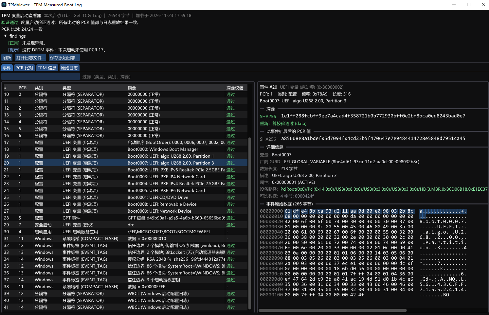

# TPMViewer

Windows TPM 2.0 度量启动（Measured Boot）分析工具：读取本次启动的 TCG 事件日志，重放 PCR 并与 TPM 实际值比对，验证启动链是否被篡改。

C/C++ + ImGui + DirectX 11，解析逻辑参考 [TheCruZ/BootViewer](https://github.com/TheCruZ/BootViewer)。



## 功能

- **读取 TPM**：通过 TBS 读取本次启动的事件日志和 PCR 实时值（失败时试试管理员运行）
- **打开日志文件**：加载 `.log` / `.bin` 离线分析，也可导出保存
- **PCR 重放**：日志逐条扩展算出每个 PCR 的期望值，与 TPM 实际值比对
- **摘要校验**：每条事件重算哈希，与日志记录值比对，发现单条篡改
- **事件解析**：UEFI 变量（SecureBoot / PK / KEK / db / dbx / Boot####）、镜像加载、GPT、ACPI/SMBIOS 等
- **SIPA 解析**：bootmgr 的 TLV 度量数据（代码完整性、模块清单、BitLocker、VBS 等）
- **驱动报告**：Win11 25H2+ 且开启 VBS/HVCI 时，通过 `GetRuntimeAttestationReport` 列出安全内核签发的驱动清单
- **拷贝**：所有表格右键拷贝单元格/整行（Tab 分隔，可粘进 Excel）；hex 视图支持左键拖选 / Shift 扩选，右键拷贝（hex 带空格 / hex 连续 / ASCII）

## 界面

| 标签 | 内容 |
|---|---|
| 事件 | 事件列表（可过滤）+ 详情（摘要、扩展后 PCR、字段、SIPA 树、原始数据 hex） |
| PCR 比对 | 按哈希库分组，期望值 vs 实际值 |
| TPM 信息 | 设备、固定属性、PCR 库、日志头 |
| 原始日志 | 整段日志 hex（可拖选拷贝） |
| 驱动 | 运行时证明驱动报告（满足条件时显示） |

顶部给出总体结论：验证通过 / 需要注意 / 比对不一致。

## 构建

要求：Windows 10/11 + Visual Studio 2019 (v142) + CMake 3.15+。ImGui（v1.91.8）已内置于 `deps/imgui/`，运行库静态链接（/MT），产物单文件免安装。

```powershell
cmake -S . -B build -G "Visual Studio 16 2019" -A x64   # 首次配置
cmake --build build --config Release                     # 编译
build\Release\TPMViewer.exe
```

## 源码结构

```
src/
├─ main.cpp          # Win32 窗口 + DX11 + ImGui 主循环 + 中文字体
├─ app.cpp/.hpp      # UI 各标签页与状态
├─ tbs_api.cpp       # TBS API 封装，手工拼 TPM 2.0 命令
├─ tcg_log.cpp       # TCG 事件日志解析
├─ replay.cpp        # PCR 重放与比对
├─ sipa.cpp          # SIPA TLV 解码
├─ driver_report.cpp # 运行时证明驱动报告（Win11 25H2+）
├─ hash.cpp          # SHA1/SHA256 封装
└─ util.cpp          # hex 转储等小工具
```

核心文件顶部有学习注解（结构图 + 逐函数说明），阅读顺序建议：`tbs_api` → `tcg_log` → `replay` → `sipa`。

## 说明

- 本地重放只能证明"日志与 TPM 自洽"；固件度量代码本身被篡改时两者会一致地说谎，需结合远程 Quote 验证
- 日志第 1 条（Spec ID）和 NO_ACTION 事件不参与 PCR 扩展
- 中文界面用系统微软雅黑，缺失时自动回退
